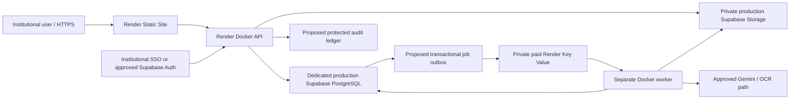

# Production architecture and security release gates

Prepared 2026-10-20. Status: DESIGN WITH EXPLICIT IMPLEMENTATION GAPS.
The existing synthetic staging demo remains the only supported hosted mode.
Production mode fails closed in code; no environment flag unlocks clinical use.
No infrastructure, schema, RLS, identity provider or medical-data processing was provisioned.

## Deployment boundaries

The production identity, outbox, queue consumer, audit ledger and tenant policies in
this diagram are NOT implemented. The production Blueprint template intentionally
has unresolved region/release placeholders. Its worker entry point exits with status
78 and performs no I/O. Do not confuse it with a functioning durable worker.

| Component | Staging implementation | Production requirement |
|---|---|---|
| Frontend | React/Vite static site; Basic demo sign-in; memory-only credentials | institutional identity/session flow |
| API | FastAPI; every API route protected; exact HTTPS CORS | verified individual identity, tenant/action policies |
| Records | existing batches JSONB; conditional updated_at writes | confirmed RLS, auditable transactions, service-role scope review |
| Originals | private bucket; backend-mediated authenticated downloads | organization ownership and purpose-of-use authorization |
| Processing | bounded in-process task; durable batch status | durable outbox, leases, separate consumer and recovery |
| Audit | field review metadata only | immutable access/change/approval/export ledger |
| Infrastructure | two staging services, no paid resources added | approved region, paid API/worker/queue capacity and operational controls |

Staging and production must use separate Supabase projects, buckets, identity
applications, credentials and Render services. Never copy clinical data to staging.
Names in the templates identify resources, not assumed institution URLs or credentials.
The existing cloud deployment mode remains a backwards-compatible staging alias.

## Completed code hardening

- Supabase is the durable authority for hosted originals and records. No hosted
  local JSON fallback. Scratch rendering/downloads and regenerated Excel files are disposable.
- Stale cloud saves use the existing updated_at column as an optimistic concurrency
  token. Conflicts require reload; no blind upsert over reviewed values.
- Reprocessing existing extracted records is rejected. Existing page/form identifiers,
  FieldValue provenance and reviewed-value priority are preserved.
- Cloud/staging requires synthetic DEMO_MODE, exact HTTPS frontend origins and shared
  restricted demo credentials; production mode is unconditionally blocked.
- Streamed request/body cap operates before multipart parsing, with bounded file reads,
  detected/declared MIME agreement, PDF encryption/page checks and image pixel checks.
- Accepted page counts are retained in new upload manifests; missing processed pages
  are represented by pending commitments so they cannot silently vanish from review/export.
- A modest per-process upload rate cap and single active batch cap bound demo resource
  use. These are NOT distributed abuse controls or a production queue.
- Non-root Docker image copies application sources only. No secrets or medical
  artifacts belong in build contexts. Access logs are disabled. Safe failure responses
  avoid provider exception bodies and candidate patient/commitment values.
- /live is process liveness. /ready and compatibility /health check configured storage
  reachability and bucket privacy without writing data. Readiness does not certify RLS,
  write privileges, backup coverage or clinical readiness.
- Frontend deployment build validates the public environment-variable allowlist and
  HTTPS API origin. Authentication failures return users to sign-in.

## Durable processing design (P0: not implemented)

Render Key Value plus a dedicated worker is appropriate as a transport, with Supabase
PostgreSQL remaining the authoritative job/outbox store. A free ephemeral Redis-like
queue is unsuitable as the only durable source. Paid journal/snapshot persistence can
still lose recent queue writes, so the database outbox must recover missing messages.
See [Render Key Value persistence](https://render.com/docs/key-value#data-persistence).

Proposed implementation after explicit schema approval:

1. Add a job/outbox contract in PostgreSQL (schema/RPC work requires approval). A
   transaction records the queued job and the batch state together. Do not perform
   independent database-save/enqueue operations and claim atomicity.
2. Job identity is based on immutable input manifest hash, batch identifier and
   extractor/schema version. Enforce a unique idempotency constraint. Queue payloads
   contain opaque job identifiers only: never patient values, PDF bytes, credentials
   or signed document URLs.
3. An outbox dispatcher publishes to a private Key Value instance and records delivery.
   Poll/replay undelivered outbox entries after restart; duplicate messages are expected.
   Choose a maintained worker framework such as RQ only after confirming timeout,
   acknowledgement and lease semantics; no queue library is silently introduced here.
4. The worker claims a database lease with compare-and-swap. Proposed states are
   queued, leased/processing, retry_wait, completed, completed_with_errors, failed and
   cancelled. Persist lease owner, expiry, attempt count, next retry and heartbeat.
   Initial design: renew every 30 seconds on a 90-second lease; size these after load
   measurements. A stale worker must fail its lease/fencing check before committing.
5. Persist one page checkpoint per document/page. Use a deterministic record identifier
   and a unique page key. Merge by that key under a batch version check rather than
   appending duplicate records. Never replace human_verified field values or reset
   review states. Current random IDs and whole-batch final save are retained only for
   staging; they are NOT claimed to implement this production checkpoint mechanism.
6. Bound transient attempts (proposed maximum three), exponential backoff with jitter,
   and a finite per-page and per-job deadline. Distinguish retryable provider/network
   errors from invalid documents, authorization failures and permanent validation errors.
   Retry only unresolved work, never all pages over completed human review. Gemini
   request retry semantics, quota limits and possible duplicate provider charges need
   explicit operational approval before enabling real extraction.
7. Every recognized page must have exactly one commitment, including terminal failures
   as pending/manual-review records. Required missing/unreviewed fields block export.
   A document that cannot be enumerated must block batch completion/export as incomplete.
8. Acknowledge transport messages only after durable progress/result commit. Reconcile
   expired leases with job checkpoints. Exhausted attempts enter a visible failed/dead-
   letter state with an authorized operator retry path and audit event.
9. Graceful shutdown stops claiming new jobs, finishes/checkpoints a bounded page or
   releases its lease. Deploy API and worker from the same approved revision. Do not
   run the API's in-process scheduler in production as a fallback.

No job tables, RPCs, queue deployments or migrations were created. The template's
worker is intentionally a nonfunctional preflight blocker. A durable queue/worker and
restart/duplicate-delivery validation remain a PRODUCTION BLOCKER.

## Identity and authorization design (P0: not implemented)

Confirm the institution's IdP, SSO protocol, account lifecycle and MFA requirements.
Prefer the approved institutional SSO; Supabase Auth may broker identities if security
and privacy approve. Do not invent an issuer, organization domain or SSO configuration.

The production API must validate token signature using a vetted JWT/JWKS library,
allowlist algorithms, check exact issuer/audience, exp/nbf, subject and session status,
and fail closed on unknown keys or verification errors. Bound JWKS cache/refresh and
plan signing-key rotation; never accept a decoded-but-unverified token or trust a user-
supplied role/tenant. See [Supabase JWT guidance](https://supabase.com/docs/guides/auth/jwts).

Individual accounts require server-controlled organization membership and role
assignments. Suggested roles (institution must approve): intake, reviewer, approver,
exporter and administrator. Build an explicit action matrix. Administrators must not
automatically inherit permission to read patient content. Resolve tenant/organization
from trusted membership, and authorize every batch read, source download, field edit,
approval, export and job retry against that membership. Enumeration, cross-tenant
references and relationship edits need the same checks.

Enforce MFA assurance for high-risk operations where required, token/session revocation,
short-lived access, refresh rotation and account disablement. Choose the browser token
or same-site HttpOnly session design with the institution; if cookies are used, implement
CSRF protection and approved SameSite/CORS behavior. Do not put service-role credentials
or shared demo credentials into JWT claims, browser bundles or persistent browser storage.

All document access must be authorized before streaming. Prefer backend-mediated
private downloads; any approved signed URL must be short-lived, tenant-scoped and
excluded from logs. RLS must enforce least privilege even for direct client requests.
Service-role access bypasses RLS, so application tenant checks and privileged-client
scope must be reviewed separately; it is not a substitute for user authorization.
See [Storage access controls](https://supabase.com/docs/guides/storage/security/access-control).

## Audit, clinical privacy and operational controls (P0/P1)

Before clinical use, implement a protected append-only ledger for viewing, downloading,
editing, approving, exporting, administrative access and retries. Include actor, trusted
organization, action, resource/page identifier, version, timestamp, outcome, request ID
and approved reason/purpose. Never log patient field values or credentials in general
application logs. Where change details must be retained, encrypt/protect them under the
approved audit access/retention policy. Use DB transactions for mutation plus audit;
fail closed on missing audit writes for approvals/exports. Auditing a view/download
must occur before releasing content. Export must reference the checked batch version
and include an audit artifact hash so concurrent changes cannot invalidate its review gate.

Institutional sign-offs required before real patient data:

- Clinical/laboratory owner: workflow, required fields, separation of duties and extraction accuracy.
- Security/identity team: SSO/MFA, threat model, pen-test, RLS/service-role review and incident response.
- Privacy/data-protection officer and institutional legal/compliance: lawful purpose,
  data minimization, retention/deletion, vendor/subprocessor agreements and applicable obligations.
- Data-residency owner: approved Render/Supabase/AI regions, cross-border transfers,
  data flows and vendor terms. The production template deliberately does not select a region.
- Platform/operations: secrets ownership/rotation, backup/PITR and Storage-object backup,
  restore drills, approved RPO/RTO, monitoring, on-call response and release/rollback authority.

Back up database records AND originals; a DB snapshot alone is not proof of object
restore coverage. Define retention and legal holds across originals, records, exports,
queue payloads, audit events and backups. Deletions require explicit approval and an
auditable, scoped procedure. No destructive cleanup is implemented in this task.

Add distributed request/user limits, per-tenant quotas, concurrent-job limits, document
malware scanning/quarantine, pixel/page/byte budgets, outbound egress controls and a
reviewed CSP. Monitor queue/outbox age, stale leases, failure rate, storage readiness,
CAS conflicts, authentication failures, memory/CPU and disk usage. Alerts must contain
opaque operational IDs, not patient content. Assign thresholds and on-call owners
before enabling production; configure and test alert delivery only after approval.

## Resource and cost decision

The staging blueprint remains a two-service synthetic demo with a free backend plan;
free compute is not a production availability commitment. Production template sizing
is an unmeasured starting estimate: API 1 CPU/2 GB, worker 2 CPU/4 GB with one active
job, private Key Value 256 MB with noeviction and journal-snapshot persistence. A paid
Supabase plan/backup strategy and monitoring/edge controls may also be required.
No prices are promised. Get current quotes and institution-approved resource/region
budgets before provisioning. The template contains unresolved placeholders and must
not be applied. No paid services were created.

## Prioritized release blockers

| Priority | Blocker | Evidence required to close |
|---|---|---|
| P0 | Production is intentionally disabled | reviewed implementation of all clinical release gates; explicit institutional release approval |
| P0 | Individual identity/RBAC/tenant authorization missing | verified SSO/JWT lifecycle, role matrix and cross-tenant denial cases |
| P0 | Durable queue/outbox/worker missing | approved schema work; restart, lease expiry, duplicate delivery and checkpoint recovery evidence |
| P0 | Audit and clinical privacy approvals missing | transactional audit design/implementation and institutional sign-offs |
| P0 | New deployment/runtime changes not exercised | exact focused validation listed in DEPLOYMENT.md |
| P1 | No distributed limits, malware quarantine or operational alerts | abuse/load limits, scanning design, monitored failure paths and on-call ownership |
| P1 | Backup/restore and retention not approved | combined DB/object restore evidence, RPO/RTO, deletion/legal-hold policy |
| P1 | Production dependencies/image not reproducibly locked/scanned | reviewed locks/base-image digest, SBOM and vulnerability review |
| P2 | Localization, CSP refinement and operator recovery UX | usability/accessibility checks and institution-approved policies |

No regulatory compliance or production readiness is claimed by this document.
